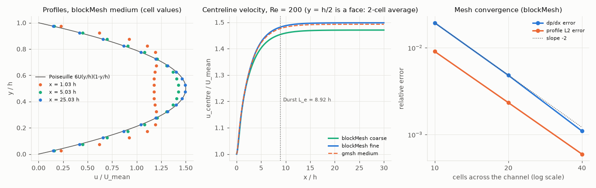

# flame-to-flow

> Personal learning project, built pairing with Claude Code.

[](https://github.com/builtbyshailendra/flame-to-flow/actions/workflows/ci.yml)

A methane-air flame computed in **Cantera**, whose hot products are then pushed through a 2-D channel in **OpenFOAM** on two independently made meshes, one from **blockMesh** and one from the **Gmsh** Python API. Each step is checked against an answer known without the tools: the adiabatic flame temperature, measured flame speeds, plane Poiseuille flow, an entrance-length correlation, and the other mesh.

Built 26 Nov 2026 to learn the three tools. Cantera and Gmsh run locally (Windows) and in CI; OpenFOAM v2406 runs only in GitHub Actions, from the `opencfd/openfoam-run:2406` Docker image. All cases are textbook ones; nothing here is a real burner or duct.

```text
Cantera, GRI-Mech 3.0 ──► T_ad, S_L, ignition delay ──► checked: 2225 K, heat-flux measurements (Hermanns 2007)
        │
        └─ burnt gas at 1500 K: rho = 0.2245 kg/m^3, mu = 5.42e-5 Pa s ──► nu = mu/rho = 2.414e-4 m^2/s
                                                                              │
blockMesh (3 levels) ──────────────┐                                         ▼
Gmsh API ─► .msh 2.2 ─► gmshToFoam ─┴─► simpleFoam (laminar, Re = 200) ─► postProcess -func sample ─► pytest
                    └─ fix patch types                    checked: u_max/U = 1.5, dp/dx = -12 mu U / h^2,
                                                          entrance length (Durst 2005), blockMesh vs Gmsh
```

## Run it

```bash
pip install cantera==3.2.0 gmsh==4.15.2 numpy==2.5.5 matplotlib==3.11.2 meshio==5.3.5 pytest==9.2.0
python -m pytest                      # 64 test cases; the 34 OpenFOAM ones skip without OpenFOAM
python scripts/flame_study.py         # the full Cantera sweep: about 12 minutes on the laptop
python scripts/flame_study.py --quick # CI size: 3 mixtures, coarser grid, about 1 minute
```

OpenFOAM is found either natively (`simpleFoam` on PATH, environment sourced) or through Docker:

```bash
export F2F_FOAM_IMAGE=opencfd/openfoam-run:2406   # Linux with Docker; CI does exactly this
python -m pytest -m foam                          # builds and runs the 4 cases (about 10 s of solving)
python scripts/flow_study.py                      # writes results/flow.txt, flow_summary.json, flow.png
python scripts/exercise.py --re 400 --length-h 60 --nx 480   # one case with your own settings
```

Cases are built in `work/` (or `$F2F_WORK`); nothing OpenFOAM writes is committed. In CI the **flame** job runs every test that doesn't need OpenFOAM plus the quick Cantera study (about 2 minutes); the **flow** job pulls the image, runs the four OpenFOAM cases through pytest, writes the report and uploads it with every case's logs and sampled files as an artifact (about 1 minute). A branch named `exercise-...` with an `exercise.txt` runs `scripts/exercise.py` once per line (see `LEARN.md`).

## Step 1: Cantera

GRI-Mech 3.0 (`gri30.yaml`), methane in air (O2 + 3.76 N2), 1 atm, unburnt gas at 300 K, mixture-averaged transport. All numbers in this step are from the full local run (`results/flame.txt`, Windows laptop, Cantera 3.2.0); the CI quick run reproduced every value it shares with it to the printed digits.

**(a) Adiabatic flame temperature** (`equilibrate("HP")`, 17 mixtures in 2.2 s):

| phi | 0.6 | 0.8 | 1.0 | 1.05 | 1.2 | 1.4 |
|---|---|---|---|---|---|---|
| T_ad (K) | 1665.9 | 1996.9 | **2225.5** | 2232.4 (peak) | 2136.5 | 1979.8 |

Stoichiometric 2225.5 K against the expected ~2225 K. The peak is slightly rich (phi 1.05) because the products dissociate: at 2225 K the equilibrium gas holds 0.9% CO and 0.3% OH.

**(b) Laminar flame speed** (`FreeFlame`). First a grid study at phi = 1, each level continuing from the previous solution:

| ratio | slope | curve | points | S_L (m/s) | thickness (mm) | time (s) |
|---|---|---|---|---|---|---|
| 3 | 0.1 | 0.2 | 125 | 0.3851 | 0.441 | 34.4 (first solve) |
| 3 | 0.06 | 0.12 | 187 | 0.3828 | 0.438 | 3.4 |
| 3 | 0.03 | 0.06 | 357 | 0.3784 | 0.437 | 10.3 |
| 2 | 0.02 | 0.04 | 514 | 0.3766 | 0.437 | 15.2 |
| 2 | 0.01 | 0.02 | 982 | 0.3751 | 0.437 | 42.9 |
| 2 | 0.005 | 0.01 | 1907 | 0.3742 | 0.437 | 60.0 |

S_L keeps falling as the grid refines and roughly halves its change per doubling of points: first-order convergence (upwinded convection). Richardson extrapolation from the last three levels gives **0.3731 m/s** (observed order 0.91). Cantera's own example settings (3, 0.06, 0.12) are 2.6% above that; the sweep below uses (2, 0.02, 0.04), 0.9% above it.

The sweep, 13 flames in 456 s (the flame nearest phi = 1 solved from scratch, every other phi continued from it), against heat-flux-method measurements at 298 K and 1 atm (Hermanns 2007, PhD thesis, TU Eindhoven, Table E.3, [doi:10.6100/IR630126](https://doi.org/10.6100/IR630126)); `results/flame_speed.csv`:

| phi | 0.70 | 0.80 | 0.90 | 1.00 | 1.05 | 1.10 | 1.20 | 1.30 |
|---|---|---|---|---|---|---|---|---|
| Cantera, 300 K (m/s) | 0.1932 | 0.2713 | 0.3364 | **0.3764** | **0.3835** | 0.3798 | 0.3333 | 0.2357 |
| measured, 298 K (m/s) | 0.167 | 0.258 | 0.327 | 0.364 | 0.372 | 0.370 | 0.327 | 0.230 |
| difference | +15.7% | +5.2% | +2.9% | +3.4% | +3.1% | +2.6% | +1.9% | +2.5% |

- Stoichiometric 0.376 m/s, inside the expected 0.36-0.39 m/s; the peak is at phi = 1.05 in both.
- The 2 K difference in unburnt temperature is worth 1.0%: the same flame at 298 K gives 0.3725 m/s, **+2.3%** against the measured 0.364. Of the remaining gap, about 0.9% is grid error (above) and the rest is the mechanism.
- GRI-Mech 3.0 is fast on the lean side: +16% at phi = 0.7, +5% at 0.8. Near stoichiometric and rich it is within 2-3.5%.

**(c) Ignition delay** (constant-pressure reactor, phi = 1, time of the steepest temperature rise; 14 runs in 7.6 s):

| T0 (K) | 1200 | 1300 | 1400 | 1500 | 1600 | 1700 | 1800 |
|---|---|---|---|---|---|---|---|
| 1 atm (ms) | 45.49 | 11.67 | 3.438 | 1.171 | 0.4673 | 0.2159 | 0.1122 |
| 10 atm (ms) | 4.682 | 1.453 | 0.4993 | 0.1871 | 0.07603 | 0.03365 | 0.01631 |

ln(tau) against 1/T0 is a straight line: apparent activation energy **181 kJ/mol** at 1 atm (R^2 = 0.99979) and 170 kJ/mol at 10 atm (R^2 = 0.99854). Ten times the pressure shortens the delay 6.1 to 9.7 times (tau ~ P^-0.8 to P^-1.0). These are not compared with shock-tube data here (see Limits).

**(d) The burnt gas as the OpenFOAM fluid** (phi = 1, 1 atm, `results/products.json`):

| state | T (K) | rho (kg/m^3) | mu (Pa s) | nu = mu/rho (m^2/s) |
|---|---|---|---|---|
| at the flame temperature | 2225.5 | 0.15019 | 7.092e-5 | 4.722e-4 |
| cooled to 1500 K, re-equilibrated (used) | 1500.0 | 0.22449 | 5.420e-5 | **2.414e-4** |
| cooled to 1500 K, composition frozen | 1500.0 | 0.22284 | 5.425e-5 | 2.435e-4 |

The duct uses 1500 K. Recombination on cooling changes nu by 0.8%. The burnt gas at 1500 K has 16 times the kinematic viscosity of room-temperature air, so Re = 200 in a 10 mm channel needs only 4.83 m/s.

## Step 2: the channel's known answers, and the Gmsh mesh

The channel: height h = 10 mm, length 30 h = 0.3 m, one cell thick (h/10) with `empty` front and back faces. Uniform inlet velocity U = Re nu / h = **4.8285 m/s** for Re = U h / nu = 200 (400 on the hydraulic diameter 2h), zero-gradient outlet at p = 0, no-slip walls. Fully developed, the answers are u(y) = 6U (y/h)(1 - y/h), u_max/U = 1.5 and dp/dx = -12 mu U / h^2 = **-31.404 Pa/m** (kinematic -139.889 m^2/s^2 per m). The entrance length from Durst et al. (2005), L/h = [0.631^1.6 + (0.0442 Re)^1.6]^(1/1.6), is **8.92 h**.

Before running OpenFOAM, `f2f/channel.py` solves the 1-D finite-volume equations that OpenFOAM's `Gauss linear` laplacian reduces to in developed flow (central differences between cell centres, the wall gradient over half a cell). On ny uniform cells this gives dp/dx = exact / (1 + 2/ny^2) exactly, and a profile L2 error of about 0.93/ny^2: -1.96%, -0.50% and -0.12% for 10, 20 and 40 cells. That turns "close to Poiseuille" into a sharp prediction of what the solver must produce.

The Gmsh mesh (`f2f/gmsh_channel.py`): four points and four lines with the built-in kernel, transfinite curves (nx + 1 and ny + 1 nodes), a transfinite surface recombined into quads, extruded one layer with `numElements=[1], recombine=True` into hexahedra; physical groups `inlet`, `outlet`, `walls`, `frontAndBack` and `fluid` (side surfaces classified by bounding box); written as `.msh` version 2.2 ASCII. Medium level: 4,800 hexahedra and 10,122 nodes in 0.17 s; meshio reads it back with the same counts, the 10,120 boundary quads, and spacing h/20 across.

## Step 3: OpenFOAM on both meshes

`simpleFoam`, laminar, SIMPLEC (`consistent yes`, U relaxed 0.9), `linearUpwind` convection and `Gauss linear` everywhere else, stopped by `residualControl` (p 1e-6, U 1e-7). The Gmsh case goes through `gmshToFoam`, which wrote every patch as type `patch`; `f2f/foam.py: fix_boundary` sets `walls` to `wall` and `frontAndBack` to `empty` in `constant/polyMesh/boundary`. Every case is sampled with `postProcess -func sample` (profiles across the channel at six stations, cell values) and `postProcess -func sampleCentreline` (u and p along y = h/2), and parsed in Python.

All numbers below come from CI (OpenFOAM v2406 in Docker on an Ubuntu 24.04 runner). `results/flow.txt` is the report of the run named in its first line; every green run so far printed the same numbers to the last digit, only the timings change:

| Case | Cells | Iterations | u_max/U | Profile L2 error | dp/dx (Pa/m) | Error | vs 1-D discrete | L_e / h |
|---|---|---|---|---|---|---|---|---|
| blockMesh coarse (120 x 10) | 1,200 | 194 | 1.4853 | 0.906% | -30.795 | -1.94% | +0.023% | 9.25 |
| blockMesh medium (240 x 20) | 4,800 | 164 | 1.4963 | 0.233% | -31.253 | -0.48% | +0.016% | 9.13 |
| blockMesh fine (480 x 40) | 19,200 | 160 | 1.4990 | 0.060% | -31.369 | -0.11% | +0.015% | 9.12 |
| Gmsh medium (240 x 20) | 4,800 | 164 | 1.4963 | 0.233% | -31.253 | -0.48% | +0.016% | 9.13 |
| exact | | | 1.5 | 0 | -31.404 | | | 8.92 (Durst) |

How each is measured: u_max/U is the peak of a parabola fitted to the 10/20/40 cell values at x = 25.03 h, over the inlet velocity; the profile error is the relative L2 norm of (cell value - Poiseuille) at the cell centres there; dp/dx is the least-squares slope of the centreline p over 22-28 h, times rho (OpenFOAM's p is p/rho); L_e is where the centreline velocity first reaches 99% of its mean over 20-27 h. The sampled cell values average to the inlet velocity within 4e-9 (mass check), and the cross-stream velocity at 25 h is below 3e-6 U. The runs stopped when the last residual (Uy) fell below 1e-7; p was then at 1e-9.

- **Mesh convergence:** the dp/dx error falls 1.94% → 0.48% → 0.11% (observed order 2.01, 2.13) and the profile error 0.906% → 0.233% → 0.060% (order 1.96, 1.97): second order, as the schemes promise.
- **The remaining error is the mesh's, and it was predicted:** against the 1-D discrete solution on the same number of cells, dp/dx differs by only +0.015 to +0.023%; that leftover is the flow still developing (the local gradient at 25 h is still 0.014% steeper than developed). The profile errors match the 1-D prediction (0.904%, 0.232%, 0.058%) within 0.2-2.2% of their size.
- **Entrance length:** 9.12 h on the fine mesh against 8.92 h from Durst's correlation (+2.3%), converged between the medium and fine meshes (9.13 → 9.12 h). The pressure gradient takes longer to settle than the centreline velocity: 3.6% steeper than developed at 10 h, 0.58% at 15 h, 0.09% at 20 h.
- **blockMesh vs Gmsh:** the same cells built two ways gave the same answer to 1e-9 % in every quantity (dp/dx -139.21561 m/s^2 in both), in the same 164 iterations. Within the 1% asked for by a wide margin, which shows the Gmsh geometry, the conversion and the boundary fix are right; it says nothing about graded meshes (that is the Gmsh exercise in `LEARN.md`).
- **Cost:** the four cases took 7-11 s of wall time in CI (the fine one 3-4 s of solving); the whole flow job about 1 minute, including pulling the image (about 250 MB compressed).
- Entrance pressure loss beyond the developed gradient, K = (p_in - |dp/dx| L) / (U^2/2): 0.49, 0.55 and 0.56 on the three levels (not compared with a reference here).



## What broke, and what I learned

1. **OpenFOAM v2406 writes all sampled fields of a set into one file** (`centreline_p_U.xy`: x y z p U_x U_y U_z). My reader assumed one file per field type and split the columns evenly, so `p` came back as two columns and the first CI run crashed in the analysis. Fields now carry their own component counts, and a unit test uses that exact layout.
2. **The mass check caught a missing cell.** In the second CI run the mean of the sampled cell velocities was 7.8% above the inlet velocity on the coarse mesh. There were 9 samples for 10 cells: a `midPoint` line started just inside the first cell crosses no face below it, so that cell had no midpoint. Starting and ending the lines outside the channel fixed it; a test now checks one sample per cell.
3. **dp/dx was 0.1% off the discrete answer on every mesh, so the error stopped shrinking** (observed order 3.8 instead of 2). The fit started at 15 h, where the local gradient was still 0.6% steeper than developed. The centreline velocity is within 1% by 9 h, but the pressure gradient takes about twice as long. Moving the fit to 22-28 h left a +0.015% residue on every mesh and the order became 2.0.
4. **The flame speed depends on the grid more than I expected**: 0.385 m/s on Cantera's coarse settings, 0.374 m/s on 1,907 points, still moving at first order. Cantera's own example settings are 2.6% high. A flame speed is only reported here with its refinement settings.
5. **Cantera's 1,000-point default stopped the finest grid level** (`max number of grid points reached`); `set_max_grid_points` raises it.
6. **Two of my hand calculations were wrong and the tests caught them**: Durst's L/h at Re = 200 is 8.92, not the 8.86 I first wrote, and the 1-D profile error is 0.93/ny^2, not 0.9/ny^2.
7. **Convergence was checked, not assumed.** residualControl stopped the runs after 160-194 iterations; the results then matched the 1-D discrete prediction to 0.02%, which would not happen if the iterations had stopped early.

## Limits

- **Isothermal, incompressible, non-reacting duct flow.** The products are a fluid with constant properties at 1500 K; no heat loss to the walls, no temperature or composition change along the duct, no buoyancy. A real duct of burnt gas would need a compressible, energy-solving solver (`buoyantSimpleFoam`, `rhoSimpleFoam`).
- **2-D channel only**, steady and laminar (Re = 200). No turbulence model was used or tested.
- **The blockMesh and Gmsh meshes are the same cells**, so their agreement checks the Gmsh workflow, not mesh independence; the three blockMesh levels do that.
- **OpenFOAM ran only in CI** (no local install: the laptop has no Docker or WSL). Everything about OpenFOAM here comes from CI logs and artifacts.
- **Ignition delays are not compared with experiments**: only their Arrhenius-like shape and pressure trend are checked. GRI-Mech 3.0 is not tuned for low-temperature ignition.
- **One mechanism, one transport model**: no comparison with newer mechanisms or multicomponent transport and Soret diffusion.
- The flame speed sweep is at 300 K and the measurements at 298 K; the 2 K effect was measured at phi = 1 only (1.0%).
- Timings are from one Windows laptop (Cantera) and GitHub's Ubuntu runners (CI); they vary between runs.

## Layout

| Path | What's in it |
|---|---|
| `f2f/flame.py` | Cantera: adiabatic flame, flame speed (sweep, grid study, Richardson), ignition delay, burnt-gas properties |
| `f2f/literature.py` | the known answers with sources: Hermanns (2007) flame speeds, Durst (2005) entrance length |
| `f2f/channel.py` | Poiseuille, the 1-D discrete solution (uniform or graded cells), profile, gradient and entrance-length checks |
| `f2f/gmsh_channel.py` | the Gmsh API mesh |
| `f2f/foam.py` | writing the case from `cases/channel`, running OpenFOAM (native or Docker), fixing the boundary file, reading logs and samples |
| `f2f/study.py` | the four OpenFOAM cases end to end, cached in `work/study.json` |
| `cases/channel/` | OpenFOAM case templates (`0/`, `constant/`, `system/`, with `{{placeholders}}`) |
| `scripts/flame_study.py`, `scripts/flow_study.py` | the measurements; output in `results/` |
| `scripts/exercise.py` | one channel case with your own settings |
| `tests/` | 64 test cases: Cantera (10), channel helpers (10), Gmsh (4), OpenFOAM files and readers (6), OpenFOAM runs (34) |
| `results/` | `flame.txt` and CSVs (full local run), `flow.txt` and `flow_summary.json` (CI), plots |
| `LEARN.md` | the three tools, questions to explain without notes, one hands-on exercise per tool |
